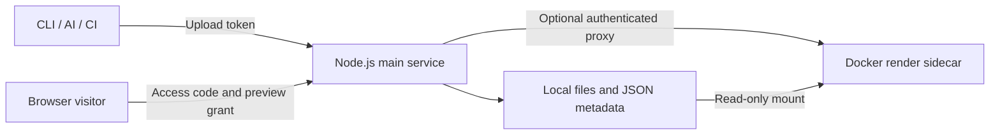

# vibeview

**Turn local HTML, images, and videos into shareable previews you can manage.**

[简体中文](README.md) · **English**

vibeview is a self-hosted preview service for AI-generated reports, charts from scripts, screenshots, and demo videos. Upload a file and view it in a browser. New uploads require an access code by default; the admin UI lets you change its expiration, reset the code, or make the preview public.

The service is named **vibeview**; its CLI is **`dview`**. Files stay on your own server. Local development does not require Docker.

[Quick start](#quick-start) · [Upload and share](#upload-and-share) · [Manage previews](#manage-previews) · [Access protection and retention](#access-protection-and-retention) · [Deployment](#deployment) · [API](#api) · [Development and tests](#development-and-tests)

## What you can do

- **Share AI output**: let others view standalone HTML reports, visualizations, and prototype pages.
- **Preview images and videos**: upload screenshots, designs, or short videos through the same workflow.
- **Keep resources organized**: see descriptions, creation dates, and resource ages; find files by source or type.
- **Connect automation**: use the CLI, curl, an AI Skill, or CI to get a preview URL, access code, and expiration time.

| Capability | Available today |
| --- | --- |
| File types | HTML; PNG / JPG / GIF / WebP / SVG and other images; MP4 / WebM videos |
| Access protection | Random codes by default, expiration, reset, public access; original files are protected too |
| Resource management | Descriptions, creation dates, age, search, filters, sorting, pagination, bulk deletion |
| Accounts | Upload tokens identify sources; usage statistics, optional quotas, disable / enable |
| Appearance | Admin pages offer light / dark / system themes, starting with light |
| Storage | Local files and JSON metadata, with a SQLite index for management queries |
| Deployment | Node.js main service with an optional Docker render sidecar |

HTML descriptions use an uploaded `description` first, then fall back to `<meta name="description">`, `<title>`, or a heading. The default file size limit is **50 MB**. Files are **kept indefinitely** by default.



## Quick start

### 1. Install and configure

Use **Node.js 22** and npm, matching the project's render image. The upload CLI needs Bash, curl, and either Python 3 or Node.js; the Skill upload script requires Python 3. Docker is only needed for the sidecar.

```bash
git clone https://github.com/lflish/vibeview.git
cd vibeview
npm ci
cp config.example.yaml config.yaml
```

Edit `config.yaml` and set at least these fields:

| Field | Value for local use |
| --- | --- |
| `server.base_url` | `http://localhost:3000`; use your actual HTTPS URL in production |
| `tokens[].name` | A unique upload source name, such as `my-machine` |
| `tokens[].token` | Your own randomly generated upload token |
| `admin.user` / `admin.password` | Your administrator username and password |
| `admin.session_secret` | Your own randomly generated session signing secret |

Run `openssl rand -hex 24` separately to generate the token and session secret. `config.yaml` is ignored by Git; keep its credentials out of the repository.

### 2. Start the service

```bash
npm start
```

Open [http://localhost:3000/admin](http://localhost:3000/admin) and sign in with the configured administrator credentials. Check health with:

```bash
curl -fsS http://localhost:3000/healthz
```

### 3. Upload a file

Configure upload credentials in another terminal:

```bash
export DVIEW_URL="http://localhost:3000"
export DVIEW_TOKEN="your-upload-token"

bash bin/dview upload /path/to/report.html --json
```

Example response; use the code and expiration returned by your actual upload:

```json
{
  "url": "http://localhost:3000/v/Ab3xK9mP2qR7sT1v",
  "id": "Ab3xK9mP2qR7sT1v",
  "source": "my-machine",
  "description": "Quarterly report",
  "access": {
    "required": true,
    "configured": true,
    "expiresAt": "2026-10-19T12:00:00.000Z",
    "expired": false
  },
  "accessCode": "G7mK9pRX4aQ2"
}
```

Open `url` and enter `accessCode` to view the preview. **Save the code and expiration; preferably share the code separately from the URL.** The server stores only the code's hash. A forgotten code must be reset; it cannot be retrieved.

## Upload and share

### CLI

Use `bash bin/dview` inside the repository, or run `npm link` to register `dview`. The CLI is distributed through this repository or the installer; it has not been published to the npm registry.

```bash
dview upload ./report.html --json                 # URL, access code, expiration
dview upload ./report.html --json --access-days 1 # Code valid for 1 day
dview upload ./public.html --public               # Explicitly allow public access
dview list                                       # This account's resources
dview me                                         # Account usage and settings
dview delete Ab3xK9mP2qR7sT1v                      # Delete this account's resource
```

Without `--json`, an upload prints the URL to stdout and the access code to stderr. **AI tools, scripts, and CI should use `--json` and retain `url`, `accessCode`, and `access.expiresAt`.** Do not embed access codes in URLs or generated HTML.

### curl

```bash
curl -fsS -X POST "${DVIEW_URL%/}/upload" \
  -H "Authorization: Bearer $DVIEW_TOKEN" \
  -F "file=@./report.html" \
  --form-string "description=Quarterly report and key metrics"
```

Optional form fields: `access_days=7` sets the code's validity in days; `access_mode=public` explicitly allows public access. Omitted fields use the server defaults.

### AI Skills and integrations

- **Claude Code**: run `bash install-skill.sh --url "$DVIEW_URL" --token "$DVIEW_TOKEN"` to install the upload Skill, `/dview` command, and CLI. By default, the installer writes environment variables to your shell configuration.
- **Codex / Cursor / other agents**: use [AGENTS.md](AGENTS.md) and the [upload Skill](skill/dview-upload/SKILL.md). After generating a file, run the CLI or `bash skill/dview-upload/upload.sh <file> --json`. The repository's installer targets Claude directories by default; install Skills for other tools according to their directory conventions.
- **Generated pages**: the upload Skill defaults to a light theme. Uploading an existing file preserves its appearance.
- **GitHub Actions**: see the [workflow example](examples/github-actions/upload-preview.yml) and configure the `DVIEW_URL` and `DVIEW_TOKEN` secrets. The example currently comments only the URL; protected previews also require saving the returned access code and choosing an appropriate way to share it.

## Manage previews

At `/admin`, you can:

- View filenames, descriptions, sources, sizes, creation dates, resource ages, and access status.
- Search filenames, descriptions, sources, or IDs; filter by type / source, sort, and paginate.
- Copy preview URLs, delete individual resources, or bulk-delete selected resources on the current page.
- Generate or reset codes under access protection, change expiration, choose no expiration, or allow public access.
- Inspect account usage and quotas, disable / enable accounts, and switch the admin theme.

Upload accounts are maintained in `config.yaml` under `tokens`. The admin UI does not currently create accounts or rotate upload tokens. Restart the main service after changing configuration.

## Access protection and retention

These three settings serve different purposes:

| Setting / credential | Purpose | Default behavior |
| --- | --- | --- |
| Upload token | Lets a machine or user upload and manage its account's files | Must be configured on the server |
| Preview access code | Lets a visitor view one preview and its original file | Randomly generated for new uploads, valid for 7 days |
| File retention | Controls automatic file deletion | `storage.retention_days: 0`, keep indefinitely |

An expired code blocks access; it **does not delete the file**. Historical previews are protected by default too; generate a code in the admin UI or explicitly make them public. Resetting a code or changing protection settings revokes existing preview grants. Restarting the main service also revokes granted preview cookies, while the access codes remain valid.

Each preview allows **10 failed attempts per 10 minutes** by default, then returns `429` with `Retry-After`. Failed attempts are counted across IP addresses and persisted; restarting cannot clear the limit. Access becomes available after the cooldown. Continued guessing can temporarily block all visitors to that preview. The current limiter is maintained by a single main-service process.

For personal use, configure one upload token and omit `max_files` and `max_storage_mb`. Account quotas are optional local file-count / storage limits; they are unrelated to paid accounts or external AI-service credits.

See [config.example.yaml](config.example.yaml) for the full configuration. Common settings:

| Field | Default / meaning |
| --- | --- |
| `server.port` / `server.base_url` | `3000` / public preview URL |
| `storage.max_size_mb` | `50`, maximum size per file |
| `storage.retention_days` | `0`; a positive value automatically deletes files older than that many days |
| `tokens[].max_files` / `max_storage_mb` | No account quota when omitted |
| `tokens[].retention_days` | Overrides global retention; `0` keeps files indefinitely |
| `access.default_required` / `protect_legacy` | `true` / `true`, protect new and historical files |
| `access.default_days` / `grant_minutes` | `7` days / `30` minutes of preview authorization |
| `access.max_attempts` / `retry_window_minutes` | `10` attempts / `10` minutes |
| `access.attempts_file` | `./data/preview-attempts.json`, persistent failed-attempt counters |
| `preview.proxy_to_render` / `render_url` | `false` / `http://127.0.0.1:3001` |

Configuration is read from `config.yaml` in the repository root. Set `DVIEW_CONFIG_PATH` (or `CONFIG_PATH`) to use another file. Relative storage paths are resolved against the **configuration file's directory**. When automatic deletion is enabled, cleanup runs at startup and every 6 hours afterward. Changing retention cannot restore deleted files.

## Deployment

### Main service

The main service handles uploads, access verification, administration, accounts, and cleanup. Run it under a process manager such as PM2 or systemd. Public deployments need a reverse proxy and HTTPS; set `server.base_url` to the actual domain.

Back up `config.yaml`, uploaded data, and restricted environment files. JSON metadata is the authoritative resource record; `data/resources.sqlite` is a rebuildable query index. Keep configured tokens, passwords, and session secrets private. Give upload credentials only to machines or users that need to upload.

### Docker render sidecar

The sidecar renders previews while the main service stays on the host. It mounts `./data` read-only and does not mount `config.yaml`. Protected previews reach the sidecar only after verification by the main service.

Stop the running main service, then execute these commands in the same terminal:

```bash
mkdir -p data/html data/images data/videos data/meta
export DVIEW_RENDER_GATEWAY_TOKEN="$(openssl rand -hex 32)"

RENDER_HOST_PORT=3001 docker compose up -d --build render
curl -fsS http://127.0.0.1:3001/healthz

DVIEW_PREVIEW_PROXY=true \
DVIEW_RENDER_URL=http://127.0.0.1:3001 \
npm start
```

The main service and Compose must use **the same** gateway secret. For production, store it in restricted environment configuration so both services retain the same value after restarts. The main service can also use `preview.gateway_token`; Compose reads `DVIEW_RENDER_GATEWAY_TOKEN`. Keep this secret out of the repository.

If the port is occupied, change `RENDER_HOST_PORT` and the main service's `preview.render_url` or `DVIEW_RENDER_URL` together. The sidecar port binds only to loopback. A sidecar failure causes preview errors without silently falling back to rendering in the main service. When using the sidecar, the main service's storage directories must match the mounted `./data` tree.

[Sidecar design](docs/design-render-sidecar.md) · [This project's TX deployment Skill](.agents/skills/deploy-tx/SKILL.md)

### Browser behavior of HTML

Upload only trusted content. Protected HTML uses `sandbox allow-scripts` to isolate same-origin privileges. Scripts can run, but browser storage and same-origin requests may be unavailable; pages relying on those features need adaptation. Explicitly public HTML does not receive that isolation. The Docker sidecar provides server-process isolation, which does not replace browser isolation.

For `NET::ERR_CERT_DATE_INVALID`, check the validity of the certificate actually served to visitors. After renewal, install the certificate and reload the reverse proxy. The [Nginx certificate helper](scripts/install-nginx-cert.sh) requires target paths matching your deployment and administrator sudo privileges.

## API

| Method and path | Authentication | Purpose |
| --- | --- | --- |
| `POST /upload` | Bearer upload token | Upload a file; return its URL, access status, and new access code |
| `GET /api/me` | Bearer upload token | Account information, usage, and quotas |
| `GET /api/me/items` | Bearer upload token | List this account's resources |
| `DELETE /api/me/items/:id` | Bearer upload token | Delete this account's resource |
| `PATCH /api/me/items/:id/access` | Bearer upload token | Change protection for this account's resource |
| `GET /v/:id` | Public, or a verified preview cookie | Show the preview; show the code form when unauthorized |
| `POST /v/:id/unlock` | Form field `code` | Verify a code and set a preview cookie |
| `GET /v/:id/raw` | Same as the preview | Retrieve the original file; supports Range requests |
| `GET /admin/api/list` | Administrator session | Pagination, search, filtering, sorting |
| `PATCH /admin/api/item/:id/access` | Administrator session | Generate / reset / change access protection |
| `DELETE /admin/api/item/:id` | Administrator session | Delete a resource |
| `DELETE /admin/api/items` | Administrator session | Bulk deletion; JSON `{"ids":["id1","id2"]}`, up to 100 items |
| `GET /admin/api/accounts` | Administrator session | Accounts and usage |
| `POST /admin/api/accounts/:name/disable` or `/enable` | Administrator session | Disable or enable an account |
| `GET /healthz` | None | Shallow health check for the main service or sidecar |

Access-protection PATCH bodies use `mode: "code"` or `"public"`, `expiresAt` (an ISO timestamp, or `null` for no expiration), and `reset: true` to generate a new code. New codes are returned only when generated; listings expose neither codes nor hashes.

The admin list accepts `page`, `pageSize` (maximum 100), `q`, `type`, `source`, `sort=time|name|size|type|source`, and `order=asc|desc`. Responses contain `items`, `total`, `page`, `pageSize`, `totalPages`, and `sources`.

## Development and tests

```bash
npm test                          # Retention, descriptions, index, upload/admin smoke
npm run test:access                # Access protection, retry limits, sidecar bypass prevention
npm run smoke:render               # Render tests; adds a real container check when Docker is available

# These require Playwright and Chromium in the environment
npm run test:admin
npm run test:theme
npm run test:access -- --browser
```

Tests use temporary configuration and data rather than existing resources. Use `SMOKE_SKIP_RENDER=1 npm test` to skip the render checks in the default suite. Browser-test dependencies must be provided separately.

```text
server.js            Main service: upload, verification, admin, account APIs
render-server.js     Optional render sidecar
lib/                 Storage, index, protection, cleanup, preview logic
views/               Admin/login pages and themes
bin/dview            Upload / management CLI
skill/ + command/    Upload Skill and Claude command
.agents/skills/      This project's TX deployment Skill
scripts/             Regression tests and deployment helpers
```

## Scope and contributions

The current scope is one administrator, local file storage, and a single main-service process. It does not include multi-admin RBAC, token creation / rotation in the admin UI, object-storage backends, or a fully containerized main service.

Issues and PRs are welcome. For bug reports, include your Node.js version, deployment mode, reproduction steps, and redacted logs. When changing defaults, update both READMEs, configuration examples, and relevant tests together.

- [Full configuration](config.example.yaml)
- [Agent instructions](AGENTS.md) · [Upload Skill](skill/dview-upload/SKILL.md)
- [Sidecar design](docs/design-render-sidecar.md) · [TX deployment Skill](.agents/skills/deploy-tx/SKILL.md)
- [Requirements and design notes](docs/SPEC.md)
