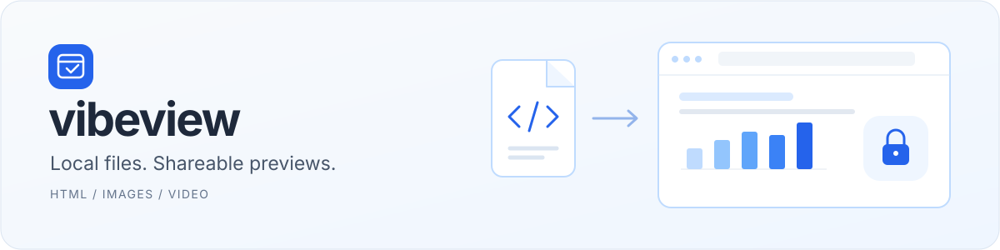
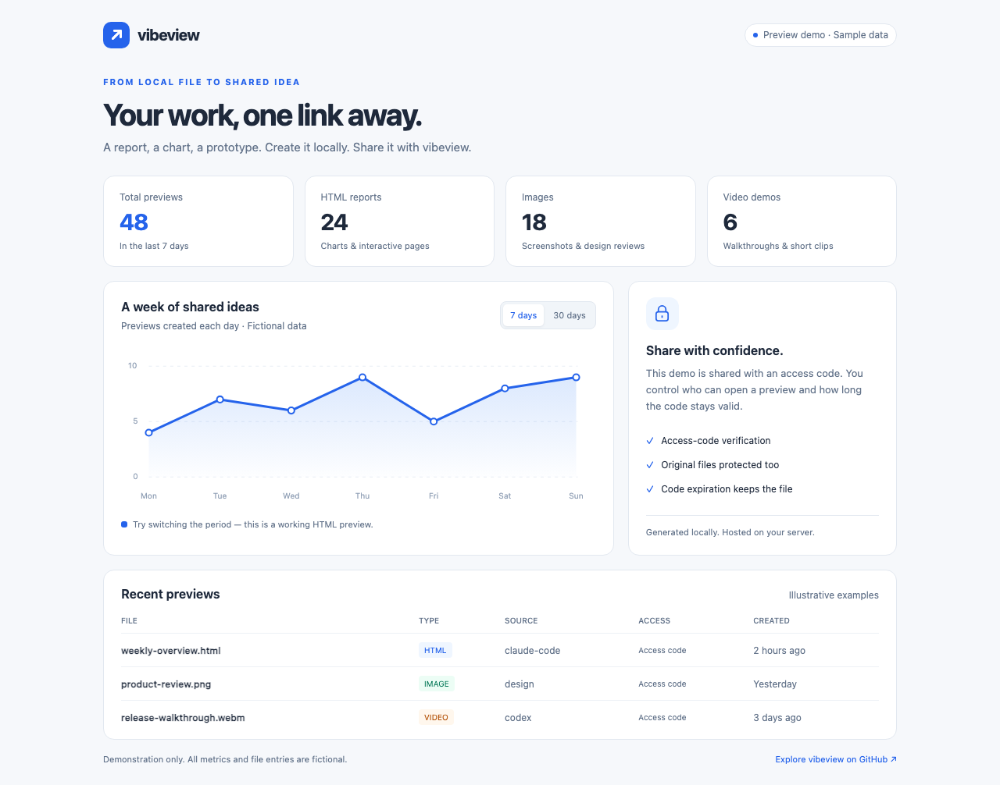
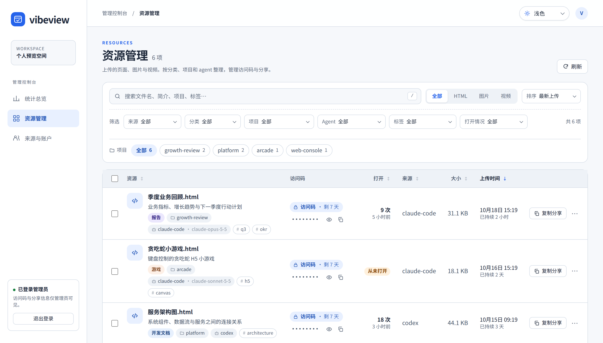
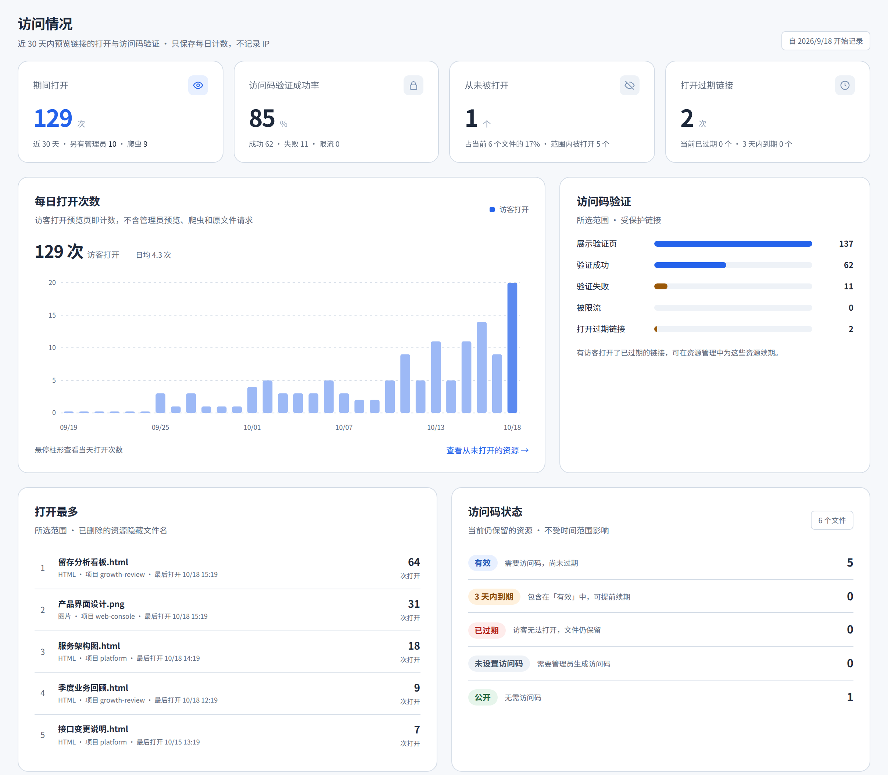
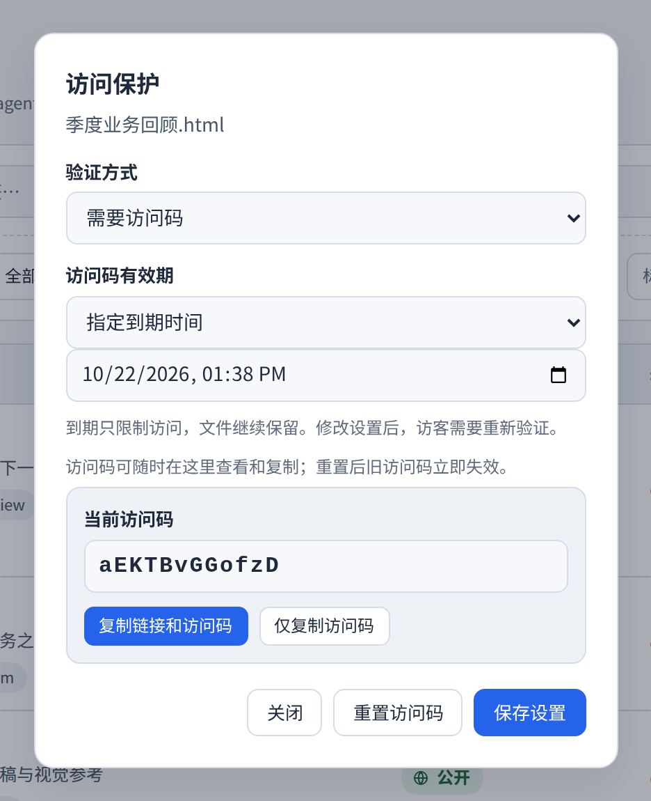

<p align="center">
  
</p>

<h1 align="center">让本地文件，成为可分享的预览。</h1>

<p align="center">
  一个轻量的自托管预览服务。<br>
  把 AI 报告、HTML 图表、截图和演示视频，变成浏览器里可打开、可保护、可管理的链接。
</p>

<p align="center">
  <a href="https://github.com/lflish/vibeview/actions/workflows/ci.yml"></a>
  <a href="https://nodejs.org/"></a>
  <a href="docs/user-guide.zh-CN.md#部署"></a>
  <a href="#访问保护与文件保留"></a>
</p>

<p align="center">
  <strong>简体中文</strong> · <a href="README.en.md">English</a>
</p>

<p align="center">
  <a href="#界面预览">界面预览</a> ·
  <a href="#快速开始">快速开始</a> ·
  <a href="#上传与分享">上传与分享</a> ·
  <a href="docs/user-guide.zh-CN.md">使用指南</a> ·
  <a href="https://github.com/lflish/vibeview/issues">反馈问题</a>
</p>

---

## 为什么用 vibeview

生成文件之后，分享和整理也应该简单。vibeview 把这两件事放在一起：用 `dview` 上传，用链接分享，再在一个管理页面里找到它们。文件保存在自己的服务器上，个人使用只需配置一个上传 token。

| 上传，即可预览 | 分享，自带保护 |
| :--- | :--- |
| HTML、图片和视频使用同一套上传流程。适合 AI 生成的报告、可视化图表、页面原型和短视频。 | 新文件默认生成随机访问码，有效期可调整。支持重置、不过期或显式公开，原文件也受保护。 |
| **文件多了，也找得到** | **接入你已有的工具** |
| 简介、来源、创建时间和持续时长一目了然；页面按分类、项目、agent 和标签整理，搜索、筛选、排序、分页和批量删除帮助管理。 | CLI、curl、AI Skill 和 CI 都能上传。管理页支持浅色、深色和跟随系统，首次默认浅色。 |
| **知道谁在看** | **按项目归档** |
| 每个链接的打开次数和最后打开时间、访问码验证成功与失败、过期链接被访问，一眼看出哪些分享有人看、哪些可以清理。只保存每日计数，不记录 IP。 | 上传时自动记录 git 仓库名作为项目。资源管理用项目导航像目录一样切换，统计也能按项目查看上传和打开。 |

**默认值：** 单文件 **50 MB** · 访问码 **7 天** · 文件**永久保留** · 账户配额**可选**。

## 界面预览

### 上传后的页面效果

[](https://view.lflish.fun/v/xE7Gp8xUszMtVoph)

[打开交互演示](https://view.lflish.fun/v/xE7Gp8xUszMtVoph) · **访问码：** `6kTR93sX9KaN` · **有效期：** 不过期 · [HTML 源文件](examples/preview-demo.html)

这是一份通过 vibeview 上传并预览的单文件 HTML 报告，使用虚构数据。打开后可以切换 **7 days / 30 days**，体验页面交互；截图取自实际线上预览。演示专门设置了不过期访问码，普通上传仍默认有效期 7 天。

也可以把仓库中的示例上传到自己的服务：

```bash
bash bin/dview upload examples/preview-demo.html --json
```

### 管理端

管理端提供资源管理和[管理统计](docs/user-guide.zh-CN.md#管理统计)：

- **资源管理**：项目导航、「打开」列，以及「从未打开 / 30 天未打开 / 7 天内打开过」筛选，按打开次数排序后可直接批量清理。
- **上传统计**：今日上传、每日趋势、上传日历，按项目、来源和类型分布。删除文件会减少当前存量，历史上传记录继续保留；上线前的数据仅能回填仍存在的文件。
- **[访问统计](docs/user-guide.zh-CN.md#访问统计)**：每日打开次数、访问码验证漏斗、打开最多的资源和访问码状态。管理员自己的预览和链接预览爬虫单独计数，不计入打开次数。



<p align="center"><sub>实际管理界面，使用隔离的演示数据截图；截图中的名称与资源仅作示例。</sub></p>

<details>
<summary><strong>查看访问统计</strong> — 每日打开次数、访问码验证、打开最多与访问码状态</summary>



<p align="center"><sub>统计总览的「访问情况」板块，使用隔离的演示数据截图。</sub></p>

</details>

<details>
<summary><strong>查看访问保护设置</strong> — 调整有效期、重置访问码、开放公开访问</summary>

<p align="center">
  
</p>

访问码到期只限制访问，文件继续保留。管理端可随时查看访问码，并一键复制「链接 + 访问码 + 有效期」；升级前生成的访问码无法查看，重置一次即可。

</details>

## 快速开始

需要 **Node.js 22** 和 npm。上传 CLI 需要 Bash、curl，以及 Python 3 或 Node.js。本地运行主服务即可使用；Docker 用于可选的 render sidecar。

**1. 安装**

```bash
git clone https://github.com/lflish/vibeview.git
cd vibeview
npm ci
cp config.example.yaml config.yaml
```

**2. 配置**

编辑 `config.yaml`：设置 `tokens[].token`、`admin.password` 和 `admin.session_secret`，为每项使用自己的随机值，例如分别运行 `openssl rand -hex 24`。`tokens[].name` 是上传来源名；本地 `server.base_url` 保持 `http://localhost:3000`。

**3. 启动**

```bash
npm start
```

打开 [http://localhost:3000/admin](http://localhost:3000/admin)，使用配置中的管理员账号登录。完整配置和健康检查见 [使用指南](docs/user-guide.zh-CN.md#快速开始)。

## 上传与分享

在另一个终端中：

```bash
export DVIEW_URL="http://localhost:3000"
export DVIEW_TOKEN="你的上传 token"

bash bin/dview upload ./report.html --json
```

响应包含预览链接、访问码和到期时间：

```json
{
  "url": "http://localhost:3000/v/Ab3xK9mP2qR7sT1v",
  "accessCode": "G7mK9pRX4aQ2",
  "access": { "expiresAt": "2026-10-19T12:00:00.000Z" }
}
```

*上面仅展示部分响应字段；访问码与时间以实际返回为准。*

打开链接、输入访问码，即可预览。AI 和脚本应保存 `url`、`accessCode`、`access.expiresAt` 三个字段；访问码不要放进链接或生成的 HTML 中。

执行 `npm link` 后，可以直接使用 `dview`：

```bash
dview upload ./report.html --json --access-days 1 # 访问码有效期 1 天
dview upload ./public.html --public               # 显式设为公开
dview upload ./snake.html --json --category game --tag h5   # 记录页面分类与标签
dview list                                       # 查看本账户资源
dview list --category report                     # 按分类 / 项目 / 标签筛选
dview edit Ab3xK9mP2qR7sT1v --category doc         # 上传后修改分类
dview me                                         # 查看用量
dview delete Ab3xK9mP2qR7sT1v                      # 删除本账户资源
```

**AI 接入：** [Claude Code 安装](docs/user-guide.zh-CN.md#ai-skill-与工具接入) · [Codex / Cursor / Agent](AGENTS.md) · [上传 Skill](skill/dview-upload/SKILL.md) · [curl 与 CI](docs/user-guide.zh-CN.md#上传与分享)。生成页面默认使用浅色风格。

## 访问保护与文件保留

| 你想控制什么 | 使用什么 |
| :--- | :--- |
| 谁能上传、管理本账户文件 | 上传 token |
| 谁能打开某个预览及原文件 | 页面访问码，默认有效期 7 天 |
| 文件什么时候被自动删除 | `storage.retention_days`，默认 `0`，永久保留 |

访问码过期**不会删除文件**。历史页面默认也加锁，在管理端生成访问码后分享。默认每个页面 10 分钟内最多失败 10 次，超限返回 `429`；限制跨 IP 累计并在重启后保留。

更多行为见 [访问保护与文件保留](docs/user-guide.zh-CN.md#访问保护与文件保留)。

管理端登录有独立的防暴力破解限制：默认同一客户端 10 分钟内最多失败 10 次，全站共享上限为 100 次，超限返回 `429` 与 `Retry-After`。计数持久化，换账号、伪造 IP 请求头或重启不能清空限制；冷却结束后恢复。详见 [管理端登录保护](docs/user-guide.zh-CN.md#管理端登录保护)。

## 部署

主服务使用 Node.js，可由 PM2 或 systemd 守护；公网部署配置 HTTPS 和实际的 `server.base_url`。可选 Docker render sidecar 只读挂载文件，通过主服务的认证代理提供预览。

[部署步骤与 gateway 密钥](docs/user-guide.zh-CN.md#部署) · [Sidecar 设计](docs/design-render-sidecar.md) · [本项目 TX 发布 Skill](.agents/skills/deploy-tx/SKILL.md)

<a id="api"></a>

## 文档与参与

| 文档 | 内容 |
| :--- | :--- |
| [中文使用指南](docs/user-guide.zh-CN.md) · [English guide](docs/user-guide.en.md) | 完整安装、CLI、curl、页面管理、配置与部署 |
| [配置示例](config.example.yaml) | 访问保护、文件保留、账户配额、Sidecar 配置 |
| [API](docs/user-guide.zh-CN.md#api) | 上传、自助管理、管理员接口与访问验证 |
| [开发与测试](docs/user-guide.zh-CN.md#开发与测试) | 本地验证命令、浏览器测试与目录结构 |
| [Agent 使用说明](AGENTS.md) · [上传 Skill](skill/dview-upload/SKILL.md) | AI 生成和上传文件的约定 |

当前适合单管理员、单个主服务进程和本地文件存储。受保护 HTML 使用浏览器 sandbox；依赖浏览器存储或同源请求的页面需要适配，详见 [浏览器行为](docs/user-guide.zh-CN.md#html-的浏览器行为)。

欢迎 [报告问题](https://github.com/lflish/vibeview/issues) 或 [贡献代码](https://github.com/lflish/vibeview/pulls)。反馈时附上运行环境、复现步骤和脱敏日志；修改默认行为时同步维护中英文文档、配置示例和相关测试。

推送到 `main` 和每个 Pull Request 都会通过 [GitHub Actions](https://github.com/lflish/vibeview/actions/workflows/ci.yml) 自动运行单元、集成、冒烟和浏览器测试；本地可用 `npm test` 与 `npm run test:browser` 复现。部署仍按需手动执行，不会自动发布到服务器。
