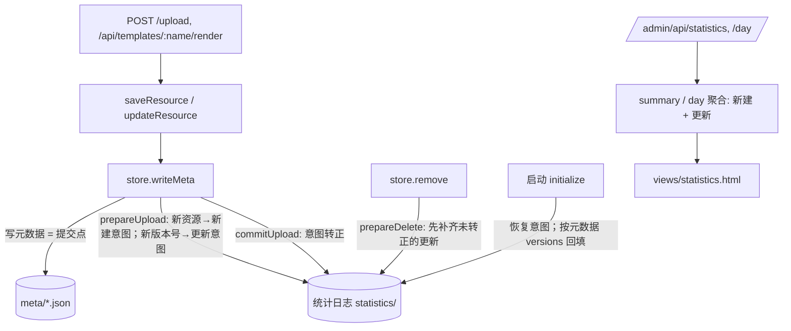

# 技术设计：统计页区分新建和更新

对应需求：spec.md（R1–R5）　更新：2026-11-09

## 1. 方案

问题的核心是“在哪里发现一次更新”。

| 方案 | 做法 | 好处 | 代价 | 结论 |
|------|------|------|------|------|
| A | 在 `store.writeMeta` 已有的统计钩子里，对比元数据的 `versions` 和已记下的更新：出现了还没记过的版本号 n（n ≥ 2），就按这个版本写一条更新意图，元数据落盘后转正 | 所有生成新版本的路径（普通上传、`.dview.json` 自动更新、模板渲染）都经过 `writeMeta`，一处改动全覆盖；沿用现有“先写意图、元数据落盘为提交点”的崩溃恢复；启动回填用同一个对比函数 | `statistics-store.js` 变大一些；要处理“版本被删后不能当成新版本”（靠已记录的 (id, n) 判断，见 5） | **选用**（原则 2：复用现有提交点和恢复机制；原则 3：新人看 `writeMeta` 就能找到） |
| B | 在 `server.js` 的 `updateResource` 里显式调用 `statistics.recordUpdate(...)` | 意图明确 | 要在 `updateResource` 自己再做一遍“意图 → 提交 → 恢复”，提交点和元数据写入分开，崩溃时可能漏记或多记；模板渲染虽然也走这里，但以后新增生成版本的路径容易漏 | 放弃 |

## 2. 总体结构



改动范围：`lib/statistics-store.js`（主要）、`views/statistics.html`、测试脚本、用户指南。`server.js` 和 `lib/store.js` 预计不用改（前置验证 V3 确认了所有路径都经过 `writeMeta`）。

## 4. 接口

### 4.1 统计模块（`lib/statistics-store.js`，模块内）

不改对外函数名和签名，只改行为：

- `prepareUpload(meta) → ticket | null`：ticket 从“一个上传事件”变成 `{ upload: event | null, updates: event[] }`；两者都空时返回 `null`。
  - 新资源（元数据文件还不存在）：`upload` 照旧；它带的版本（只有 v1）不产生更新。
  - 已有资源：**只看当前版本** `n = versions.current(meta)`：n ≥ 2 且 (id, n) 没记过，生成一条更新意图（`backfilled: false`）。每次更新正好产生一个新版本，而且它就是当前版本（`server.js:452-480`）。改访问码、分类、删除历史版本时当前版本已记过，返回 `null`。扫描全部版本只在启动回填时做，所以回填时跳过的无效版本不会在之后的元数据写入里被再次处理（工程评审 #1）。当前版本自己的记录无效（时间或大小不合法）时也返回 `null`，不抛错、不编造时间（方案验证备注 1）。
- `cancelUpload(ticket)`、`commitUpload(meta, ticket)`：处理 ticket 里的全部意图。
- `prepareDelete(meta, reason)`：在写删除意图之前，把 `pending-update/` 里属于这个资源、**且已提交**（判断同启动恢复：`versions` 里有 n，或 `current ≥ n`）的意图用 `atomic` 直接写成 `updates/<id>.<n>.json`（保留 `backfilled: false`），再删意图（没提交的直接删掉，不计，方案验证备注 3）；**写失败就抛错，删除失败**（和写删除意图失败时一致）。“是否已记”以磁盘上的 `updates/` 文件为准，不看内存（工程评审 #4）。
- `seed(meta)`（回填新建）：体积改为第 1 版的大小 `versions.find(meta, 1)?.size`，没有版本记录时退回 `meta.size`（H8）。

### 4.2 `GET /admin/api/statistics`（只新增字段，R4）

所有聚合对象（`summary.today`、`summary.uploads`、`daily[]`、`calendar.days[]`、`types[]`、`sources[]`、`projects[]`）在原有 `count`、`bytes`、`backfilledCount` 之外新增：

```json
{ "count": 5, "bytes": 2048, "backfilledCount": 0,
  "created": { "count": 2, "bytes": 1200 },
  "updated": { "count": 3, "bytes": 848 } }
```

- `count`、`bytes` 改为新建 + 更新的合计（Q1 选 A）。`summary.current`（当前存量）不变，不加这两个字段。
- 日历里未来日期：`created`、`updated` 为 `null`，和 `count: null` 一致。
- `activities[]`、`deletionActivities[]`、`/day` 的 `items[]`：新增 `uploadKind`（`"create"` | `"update"`，删除活动没有）和 `version`（新建为 1，更新为 n）。原有 `kind`（`upload` / `delete`）不变。
- `coverage` 新增 `backfilledUpdates`（回填的更新条数）、`skippedVersions`（版本记录无效、没回填的条数，R2.3）。`periodComplete` 的判断把回填的更新也算进去（范围内有回填事件就不算完整）。

### 4.3 `GET /admin/api/statistics/day`

`count`、`bytes` 为合计，新增 `created`、`updated`（同上形状）；`items` 按时间、id、版本号倒序。分页参数不变。

错误：沿用现有 400 / 401，不新增。

## 5. 数据

统计目录新增两个子目录，权限和现有的一样（目录 700、文件 600）：

| 目录 | 文件名 | 内容 |
|------|--------|------|
| `updates/` | `<id>.<n>.json` | 正式的更新事件 |
| `pending-update/` | `<id>.<n>.json` | 更新意图 |

更新事件字段（只这些，H4、R5）：

```json
{ "id": "16 位 id", "version": 3, "type": "html", "source": "alice", "project": "vibeview",
  "bytes": 18919, "at": "2026-11-08T10:31:00.000Z", "backfilled": false }
```

- `at` 取版本记录的 `createdAt`（H9），`bytes` 取版本记录的 `size`（H1）。`project` 只在有值时写（和新建一致）。
- 读取时校验：文件名里的 id 和 n 必须和内容一致，`version` 是 ≥ 2 的整数，其余规则同上传事件；不合法就报错停下（现有做法：日志损坏不能当成零）。
- 启动时“统计状态缺失”的检查（`lib/statistics-store.js:99`）把 `updates` 也算进去：有更新日志而没有 `state.json` 时同样报错（方案验证备注 4）。
- **已有数据不迁移**：`uploads/`、`deletions/`、`state.json` 原样保留，`state.version` 不变。新目录在第一次启动时创建并回填。
- 去重键是 (id, n)。`updates` 在内存里按 `id.n` 存。版本号不会复用（新版本号 = 现有最大 + 1，当前版本不能删，见 V2），所以“记过的 (id, n) 不再记”就足以区分“新版本”和“被删掉的旧版本”。

## 6. 状态和流程

一次更新（`updateResource` → `writeMeta`）：

1. `prepareUpload(next)`：发现 v_n 没记过 → 写 `pending-update/<id>.<n>.json`。写失败 → 抛错，更新失败（和新建一致）。
2. 写元数据（原子重命名）= 提交点。失败 → `cancelUpload` 删意图，不计（R1.4）。
3. `commitUpload`：意图移到 `updates/`，内存里加上。移动失败只记警告，保留意图，下次启动恢复。

启动时（`initialize`），在现有恢复之后：

1. 读 `updates/`。
2. 处理 `pending-update/`，**在现有的 `pending-upload` 之后、`pending-delete` 之前**：元数据存在且（`versions` 里有 n，或 `current ≥ n`）→ 转正（先像现有恢复一样检查 id、type 一致，不一致就报错停下）；元数据存在但两条都不满足 → 删意图，不计，并删掉可能留下的 `.versions/<n>` 目录（否则下一次更新复用 n 时重命名会失败，方案验证备注 2）；元数据不存在 → 删意图，不计（删除时已经把意图转正，留下的只可能是没提交的）（R1.7）。
3. 遍历元数据时（现有循环），对每个资源补齐：`versions` 里 n ≥ 2 且没记过的版本，记为回填更新（`backfilled: true`）；`createdAt` 无效或 `size` 不是非负整数的跳过，计入 `skippedVersions`（R2.3）。已记过的不动，所以重启、删索引后重启都不重复（R2.2）。

老代码运行期间产生的版本：下次用新代码启动时按回填补上，标“回填”。

## 7. 错误处理和安全

- 统计接口仍只认管理员 session；上传 token 401（R4.2，不改）。
- 敏感数据：更新事件只有上面列的字段，不含文件名、简介、访问码、哈希、token（R5.1）。现有单元测试“日志文件不含 PRIVATE / filename / access”的检查扩展到 `updates/`、`pending-update/`。
- 输入：接口参数不变。

## 7.1 不变的规则

| 规则 | 自动检查（命令） | 新增 / 已有 |
|------|------------------|-------------|
| 统计日志只保存最小事件，不含文件名、简介、内容、访问码、token | `npm run test:statistics`（扩展到新目录） | 已有 |
| 上传 CLI 和 HTTP 接口向后兼容 | `SMOKE_SKIP_RENDER=1 bash scripts/smoke.sh` | 已有 |
| 统计接口只新增字段，不删、不改名 | `npm run test:statistics`：断言旧字段都在（新增断言，属于已有规则的检查） | 已有 |

## 7.2 外部影响和开关

无。

## 8. 对需求的覆盖

| 需求 | 由哪部分实现 |
|------|--------------|
| R1.1–R1.3 | 4.1 `prepareUpload` 按版本号发现更新；所有路径经过 `writeMeta`（V3） |
| R1.4 | 6 第 2 步：元数据没写成就取消意图；被拒的请求不调用 `writeMeta` |
| R1.5 | 4.1：没有新版本号不记；5：(id, n) 去重 |
| R1.6 | 4.1 `prepareDelete` 先补齐；聚合时已删除的行 `filename: null` |
| R1.7 | 6 启动第 2 步 |
| R2.1–R2.4 | 6 启动第 3 步；R2.4 无元数据可回填，沿用现有覆盖提示 |
| R3.1–R3.8 | 4.2 字段 + `views/statistics.html`（任务 T4） |
| R4.1–R4.2 | 4.2 只新增字段；鉴权不改 |
| R5.1 | 5 字段清单；7.1 检查 |

## 9. 前置验证

| # | 假设 | 验证方法 | 通过标准 | 结果 |
|---|------|----------|----------|------|
| V1 | 生产资源的版本记录都有有效的 `createdAt` 和整数 `size`，可以回填 | 只读脚本遍历 `~/vibeview-prod/data/meta/*.json` 的 `versions` | 无效条数为 0 | ✅ 3 个资源 8 条版本记录，无效 0 |
| V2 | 新版本号不会被复用，新版本不会在写入时被保留上限立刻删掉 | 读 `server.js` `updateResource`（n = 最大 + 1）、`deleteVersion`（当前版本不能删）、`versions.prune`（保留 `keep = n`） | 三处都成立 | ✅ `server.js:450-459`、`server.js:518`、`lib/versions.js:46-53` |
| V3 | 普通上传、`--id` 更新、模板渲染生成版本都经过 `store.writeMeta` | `grep -n "writeMeta\|updateResource(" server.js`；读 `/api/templates/:name/render` | 渲染调用 `saveResource` → `updateResource` → `writeMeta` | ✅ `server.js:335`、`:484`、`:618-660` |
| V4 | 现有新建事件的体积没有包含后续版本（不需要修旧数据） | 只读对比生产 3 个更新过的资源：新建事件 `bytes` 和 v1 `size` | 相等 | ✅ 3 个都相等（37082、18919、16361） |
| V5 | 改访问码、改分类、删除历史版本都走 `writeMeta`，但不会出现新版本号 | 读 `server.js:522`（删除版本）、`:854`、`:886`、`:912` | 这些写入的 `versions` 只减不增 | ✅ |

## 10. 变更

- 2026-11-09 工程评审后：实时路径只看当前版本；删除前补齐改为直接写正式日志、失败即中止删除；启动顺序写明（见 decisions.md #10）。

## 11. 方案验证（机器关口 B）

- 结论：**通过，有备注**（第 1 轮，2026-11-09）
- 验证者：same（全新子 agent，没参与设计）。codex 不可用：探测返回 403 `NOT_ENOUGH_MEMBER_BUDGET`；claude 跳过（与写方案的是同一工具）
- 对照：R1.1–R5.1 每个场景都对应到设计小节和任务或测试（详见 `evidence/gate-b-verdict.md`）
- 重跑的前置验证：V1、V4 用只读脚本读生产元数据和统计日志（49 个资源，3 个多版本，5 条更新版本，无效 0；新建事件体积都等于 v1）；V2、V3、V5 逐行核对代码，都成立
- 工程评审 6 条：都已处理（`evidence/eng-review.md`）
- 备注 1–4（当前版本无效、恢复少一个分支、删除前补齐可能多记、状态缺失检查）：已写进 4.1、第 5、6 节，T1 加了对应测试
- 备注 5：R5.1 的措辞和现有行为矛盾 → c3，等用户
- 未决定、只能由用户决定的事：c2（用户指南措辞）、c3（R5.1 措辞）
